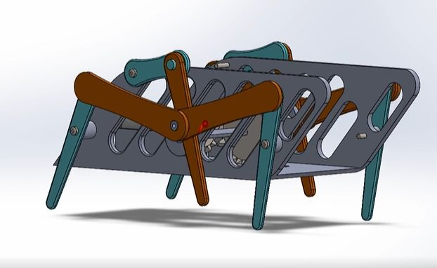
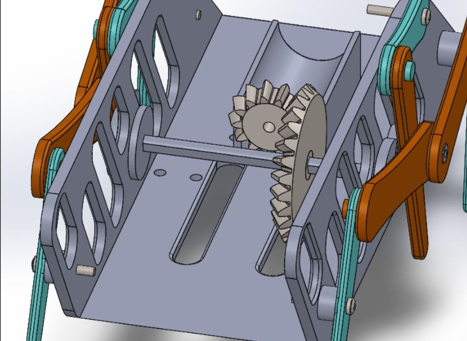
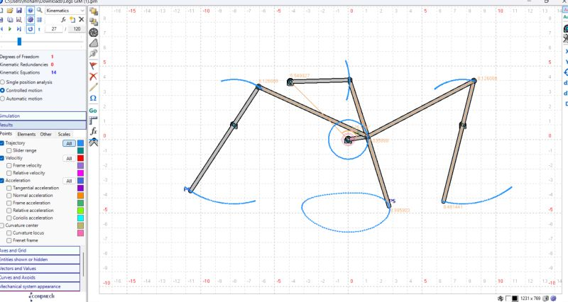
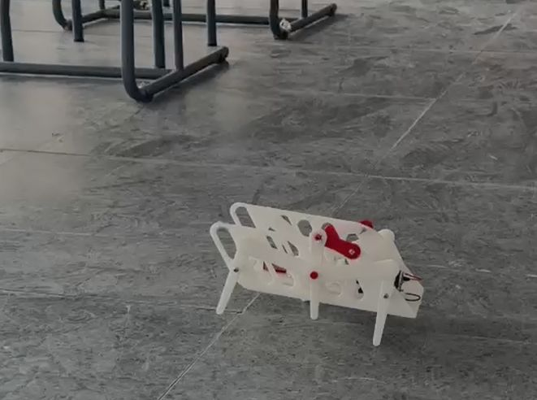

# Single-Actuator Gear-Driven Hexapod Walking Robot

## Project Overview
Course project for **MTR 221: Theory of Machines** at **Egypt-Japan University of Science and Technology (E-JUST)** under the supervision of **Dr. Ayman Nada**.

* **Team**: Abdallah Ahmed, Mohamed Eldaw, Mohamed Aborehab
* **Timeline**: Spring semester (May 2026)
* **Goal**: Mimic biological hexapod locomotion with purely mechanical synchronization driven by a single DC motor.

---

## Visual Documentation

| CAD Model & Gear Assembly | Physical 3D-Printed Prototype |
| :---: | :---: |
|  |  |
| **Internal Bevel Gear Train** | **Kinematic Trajectory Synthesis** |
|  |  |

---

## Kinematic Analysis & Mechanism Design

### 1. Mobility Calculation (Grübler's Criterion)
To ensure the multi-legged assembly is strictly driven by one input without jamming or redundant degrees of freedom, planar mobility was evaluated:

$$M = 3(n - 1) - 2j_1 - j_2$$

* $n = 4$ links (including base frame)
* $j_1 = 4$ revolute joints (pin pairs)
* $j_2 = 0$ higher pairs
* **Result**: $M = 3(4 - 1) - 2(4) - 0 = 1\text{ DOF}$ per leg module.

### 2. Linkage Synthesis (Grashof's Condition)
The leg linkages were synthesized to guarantee continuous 360° input crank rotation while oscillating the foot rocker through an oval trajectory:

$$s + l \le p + q$$

Where $s$ is the driving crank link and $l$ is the coupler link. The resulting walking locus lifts the leg during swing phase and provides forward ground traction during stance phase.

### 3. Gear Train & Torque Split
* **Bevel Gears**: 90° direction change splitting motor shaft rotation across two lateral drive shafts.
* **Pinion & Spur Gears**: Gear reduction providing speed reduction and torque amplification to sustain the robot's self-weight during 3-legged stance.
* **Gait Strategy**: Alternating tripod gait (Legs 1, 4, 5 vs Legs 2, 3, 6 phase-shifted by 180°).

---

## 3D CAD & Manufacturing Files

The CAD parts are located in the [`cad/`](cad/) directory:
* [`Upper part.stl`](cad/Upper%20part.stl) — Main chassis chassis plate
* [`the tall link.STL`](cad/the%20tall%20link.STL) — Long vertical rocker linkage
* [`upper short link.STL`](cad/upper%20short%20link.STL) — Upper rocker link
* [`Part1.STL`](cad/Part1.STL) — Pivot bracket mount

### 3D Printing Parameters:
* **Material**: PLA / PETG
* **Infill**: 40% Gyroid
* **Layer Height**: 0.2 mm
* **Pin Tolerances**: $\pm 0.15\text{ mm}$ for smooth joint pivoting without play.
