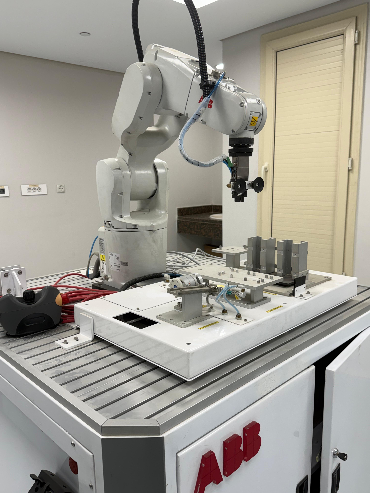
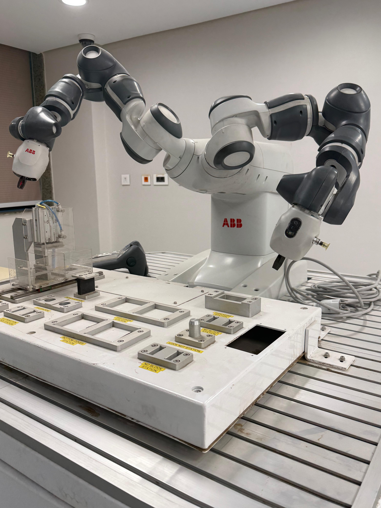
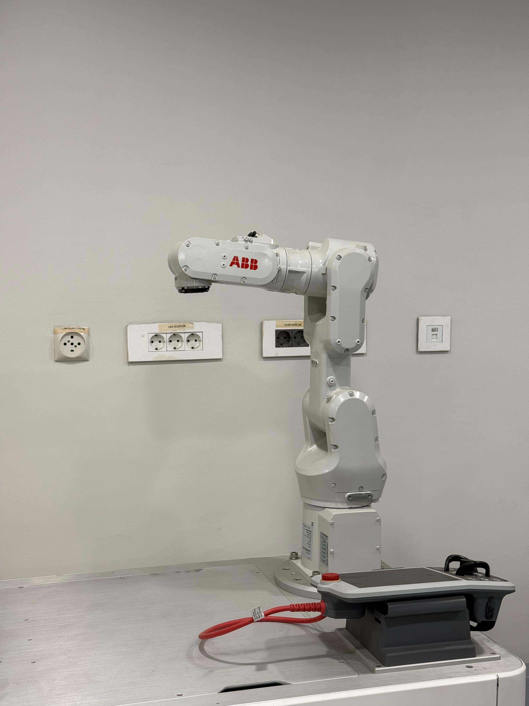
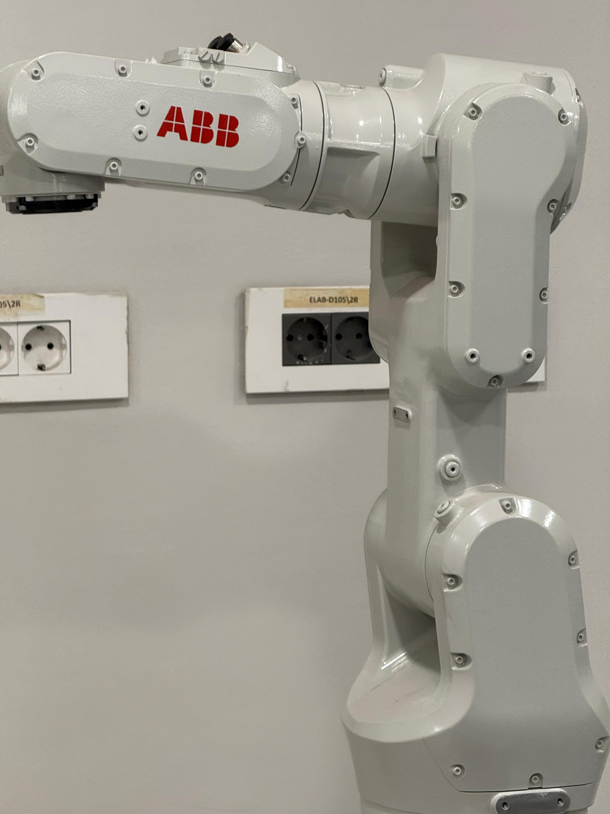
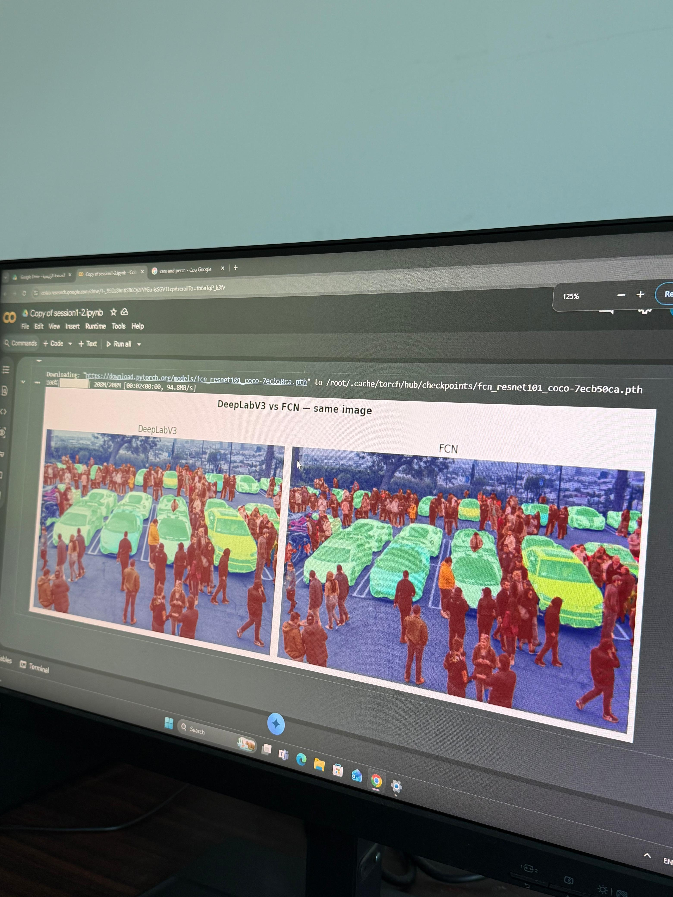
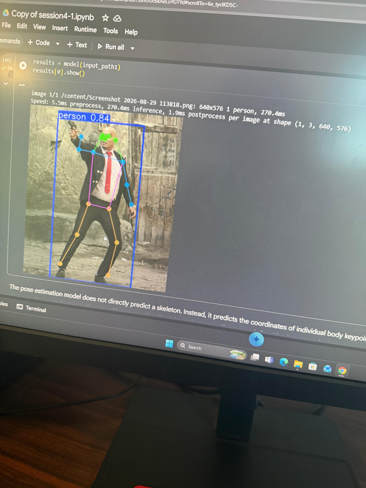
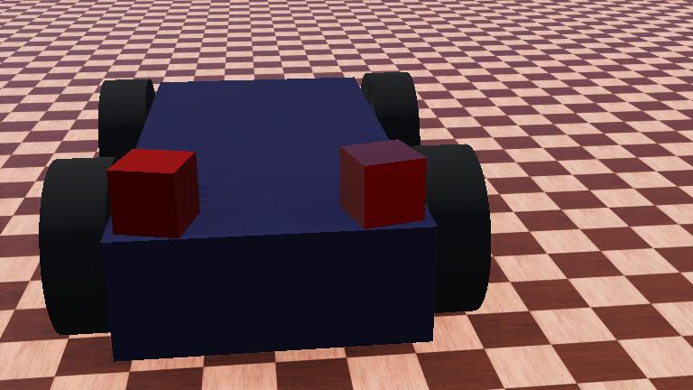

# ERI Summer Internship — Robotics & Computer Vision Track

## Overview
* **Institution**: Electronics Research Institute (ERI) — Cairo, Egypt
* **Affiliation**: Ministry of Higher Education and Scientific Research
* **Program**: Summer Field Training Program 2026
* **Track**: Robotics & Computer Vision (الروبوتات ورؤية الحاسب)
* **Duration**: ~60 training hours over 12 intensive in-person sessions
* **Location**: ERI Headquarters, Joseph Tito Street, El-Nozha El-Gedida, Cairo

---

## About the Program

The ERI Summer Training is a competitive, accredited program hosted by one of Egypt's premier national research institutions. The **Robotics & Computer Vision track** is run out of ERI's **Central Laboratory for Robotics and Automated Manufacturing** (المعمل المركزي للروبوتات والتصنيع المميكن), combining theoretical lectures by PhD-level research staff with hands-on lab sessions on industrial-grade hardware.

The program concludes with a **capstone project** integrating robotics control and computer vision inference pipelines, defended in an oral presentation evaluated by senior ERI researchers.

---

## Lab Equipment & Industrial Hardware

<table>
  <tr>
    <td align="center"><b>ABB IRB 1200 — Industrial Robot Arm</b> </td>
    <td align="center"><b>ABB IRB 14000 YuMi — Dual-Arm Cobot</b> </td>
  </tr>
  <tr>
    <td align="center"><b>ABB IRB Series — Full View</b> </td>
    <td align="center"><b>ABB Industrial Arm — Close-Up</b> </td>
  </tr>
</table>

ERI's robotics laboratory is equipped with state-of-the-art ABB hardware acquired through partnerships with **MARSES** (ABB's authorized robotic integrator in Egypt):

| Robot | Config | Key Specs |
| :--- | :--- | :--- |
| **ABB IRB 14000 YuMi** | 14 DOF dual-arm collaborative robot | 0.5 kg payload/arm, 0.02 mm repeatability, ISO/TS 15066 compliant |
| **ABB IRB 1200** | 6-axis industrial arm | 5–7 kg payload, 700–900 mm reach, RAPID programming via FlexPendant |
| **ABB IRB 4600** | Medium-duty 6-axis arm | 20–60 kg payload, up to 2.55 m reach |

---

## Computer Vision — Semantic Segmentation

  
   <em>DeepLabV3 vs FCN — side-by-side semantic segmentation comparison on the same scene</em>

### DeepLabV3 vs FCN (Fully Convolutional Networks)

A core benchmark exercise comparing two major architectures for pixel-wise scene understanding:

| Aspect | FCN (Long et al.) | DeepLabV3 (Chen et al.) |
| :--- | :--- | :--- |
| **Core mechanism** | Transposed convolutions + skip connections (FCN-32s/16s/8s) | Atrous (dilated) convolutions + ASPP module |
| **Multi-scale capture** | Limited — relies on skip fusion from shallow layers | Parallel dilated convolutions at rates 6, 12, 18 + global avg pooling |
| **Backbone** | VGG-16 / AlexNet adaptations | ResNet-50 / ResNet-101 |
| **Boundary quality** | Coarse edges, detail loss | Sharper boundaries, reduced edge bleeding |
| **Eval metric** | Mean IoU (mIoU), pixel accuracy | Mean IoU (mIoU), pixel accuracy |

---

## Computer Vision — Pose Estimation

  
   <em>YOLOv8-Pose — real-time 17-keypoint skeleton detection with bounding box and confidence score</em>

### YOLOv8-Pose Pipeline
* **Architecture**: Anchor-free single-stage detector modified for keypoint regression (Ultralytics YOLOv8-pose)
* **Output**: 17 COCO skeletal keypoints (nose, eyes, ears, shoulders, elbows, wrists, hips, knees, ankles) alongside bounding boxes and confidence scores
* **Loss function**: CIoU + Distribution Focal Loss (box), BCE (classification), Object Keypoint Similarity / OKS (keypoints)
* **Robotics application**: Safe human-robot collaboration — detecting operator proximity to ABB workcells for dynamic speed reduction or safety stops

---

## Robotics & Kinematics

### Wheeled Robot Simulation

  
   <em>Webots dynamic physics simulation — 4-wheel drive mobile robot platform</em>

* **Kinematic modeling**: Forward and inverse kinematics for differential drive and 4-wheel skid-steer platforms
* **D-H parameterization**: Denavit-Hartenberg convention applied to articulated arm configurations
* **RAPID programming**: Industrial motion commands (`MoveJ`, `MoveL`, `MoveC`) with velocity and zone tolerance tuning
* **Sensor-in-the-loop**: Simulated ultrasonic, IMU, and quadrature encoder feedback integrated with reactive obstacle avoidance controllers

### Industrial Robot Programming
* Programmed ABB arms using **RAPID** language and the **FlexPendant** teach pendant
* Configured I/O integration for pneumatic grippers and proximity sensors
* Explored **lead-through teaching** on the YuMi dual-arm cobot for safe human-robot collaboration

---

## Demo Video

> 🎥 *Robotics lab session recording — see `media/eri-robotics-demo.mp4`*
