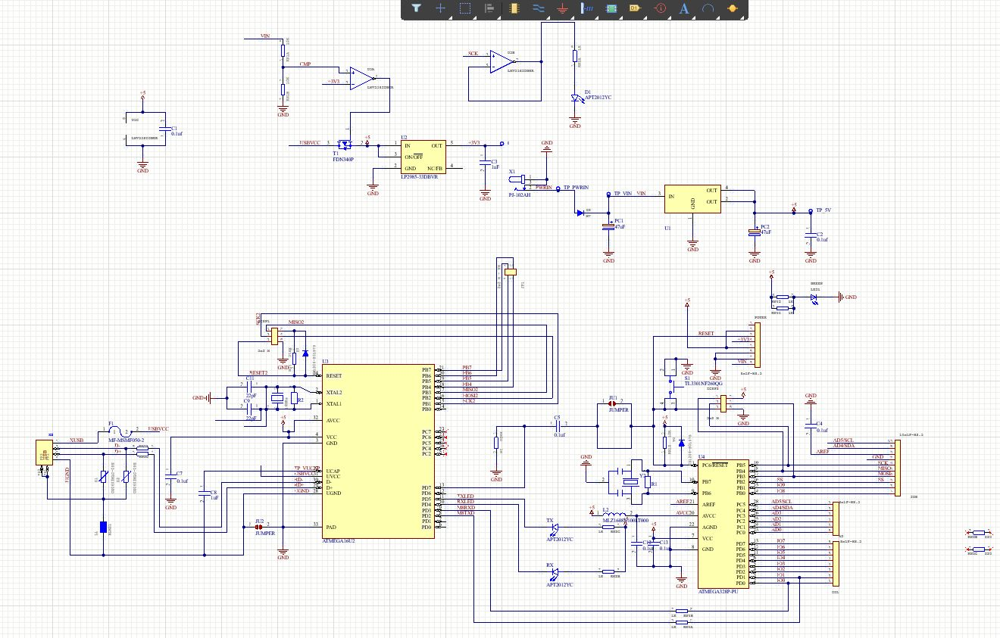

# End-to-End PCB Design: Arduino Uno R3 & 5V Regulated Power Supply

## Overview
* **Organization**: Egyptian Space Agency (EgSA) — Cairo, Egypt
* **Program**: Comprehensive 60-Hour Hardware & PCB Design Workshop (Jan 25 – Feb 5, 2026)
* **Lead Instructor**: Khaled Shahin
* **CAD Suite**: Altium Designer
* **Credential**: Comprehensive PCB Design Certificate — Egyptian Space Agency

---

## Visual Documentation

### 1. Arduino Uno R3 Compatible Board

<div align="center">
<table>
  <tr>
    <td align="center"><b>Altium 3D PCB Model</b><br></td>
    <td align="center"><b>2-Layer PCB Layout & Routing</b><br></td>
  </tr>
</table>

<br>

<b>Complete Circuit Schematic Capture</b><br>

</div>

#### Technical Specifications — Arduino Uno R3:
* **Microcontroller Core**: Microchip ATmega328P in TQFP/DIP package with 16 MHz crystal oscillator clock network and load capacitors.
* **Serial Interface**: USB-to-UART bridge interfacing with hardware RX/TX lines with activity indicator LEDs.
* **Power Management**: Dual-rail automatic power-multiplexing circuit selecting between USB VBUS and 7–12V DC barrel jack input via on-board linear voltage regulation.
* **Component Footprints**: Custom-built IPC-compliant 3D footprints and schematic symbols modeled directly from component datasheets.
* **Silkscreen**: Custom silkscreen identification marking (`MADE BY ABDALLA`).

---

### 2. 5V Regulated Low-Ripple Power Supply

<div align="center">
<table>
  <tr>
    <td align="center"><b>Altium 3D Model</b><br></td>
    <td align="center"><b>Power Trace Layout & Routing</b><br></td>
  </tr>
</table>
</div>

#### Technical Specifications — 5V Regulated Supply:
* **Input Stage**: AC/DC dual-input terminal blocks equipped with full-wave diode bridge rectification (D1–D4) for polarity insensitivity.
* **Filtering & Smoothing**: Bulk high-capacitance electrolytic capacitor (C1) coupled with parallel high-frequency ceramic decoupling capacitors.
* **Voltage Regulation**: Linear voltage regulator (TO-220 package) with dedicated copper heatsink area and thermal relief vias for heat dissipation.
* **Output Stage**: Low-noise regulated 5V DC output with screw terminal breakout and LED power indicator.

---

## Complete Engineering Workflow

```text
Component Datasheet Analysis
  └── Schematic Symbol & IPC 3D Footprint Library Creation
       └── Schematic Capture & Electrical Rule Checks (ERC)
            └── Component Placement & Netlist Synchronization
                 └── 2-Layer Layout, Polygon Pours & Power Routing
                      └── Design Rule Checks (DRC Validation)
                           └── Manufacturing Exports (Gerbers, Drill, BOM)
```

### Key Engineering Competencies Demonstrated:
* **Library Creation**: Designed accurate schematic symbols and IPC-7351 standard 3D component footprints with courtyard boundaries.
* **Trace Sizing & Current Capacity**: Calculated power trace widths according to IPC-2152 standards for safe temperature rise under nominal loads.
* **Ground Planes & EMI**: Maintained low-impedance ground polygon pours on top and bottom layers with thermal relief connections to ground pads.
* **Design Rule Checking (DRC)**: Resolved clearance violations, annular ring constraints, minimum trace widths, and solder mask slivers prior to sign-off.
