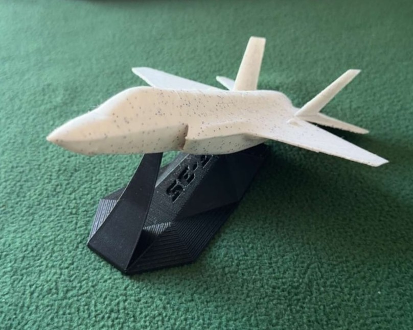

# Etba3ly — 3D Printing Services

  
   <em>FDM 3D printed F-35 Lightning II desk model — designed and printed at Etba3ly</em>

---

## About

**[Etba3ly.store](https://etba3ly.store)** is a 3D printing service I started to offer custom prototyping, scale models, and functional parts on demand. What began as a personal hobby turned into a small business serving fellow engineering students, hobbyists, and local clients.

### What We Do
- Custom FDM / resin prints from client CAD files or from-scratch design
- Rapid prototyping for engineering course projects and senior design teams
- Scale models, display pieces, and functional replacement parts
- Material selection guidance (PLA, PETG, ABS, TPU)

> 🔗 **Store**: [etba3ly.store](https://etba3ly.store)
