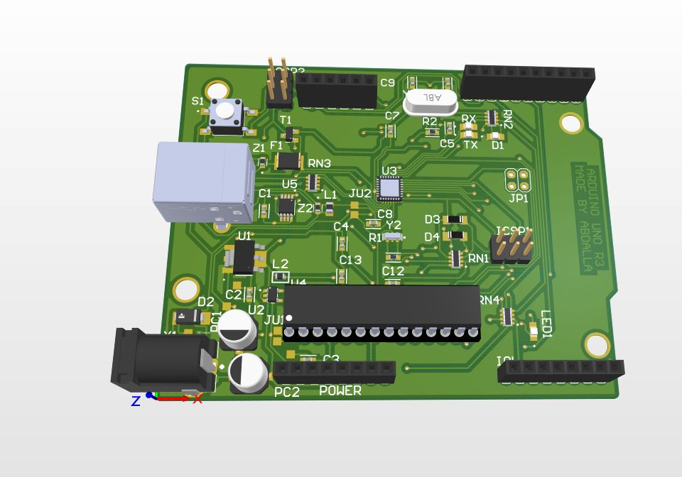
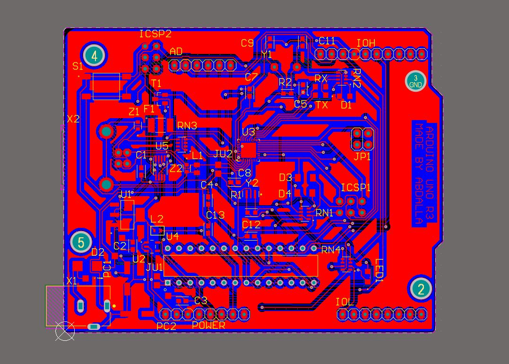
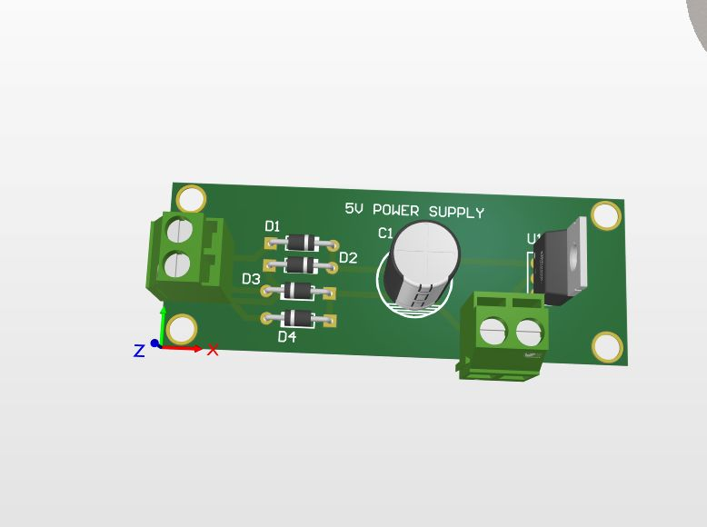
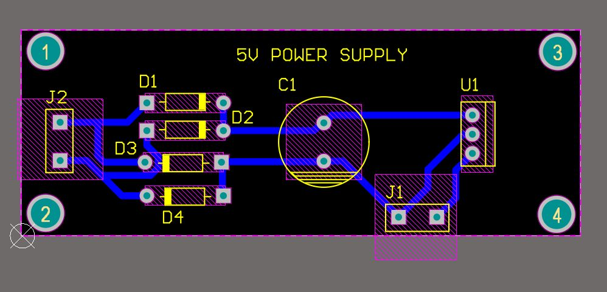

# Abdallah Ahmed — Mechatronics Engineering Portfolio

<div align="center">


### Mechatronics Engineering Student
**Egypt-Japan University of Science and Technology (E-JUST)** • Alexandria, Egypt  
*Class of 2028 • Expected Graduation: June 2028*

[](https://www.linkedin.com/in/abdallah-ahmed-4138ba344/)
[](mailto:3bdallahhahmed@gmail.com)
[](tel:+201050018069)
[-orange?style=flat-square&logo=adobeacrobatreader)](assets/Abdalla_Ahmed_cv.pdf)

</div>

---

## 📌 Executive Summary

Mechatronics Engineering student with hands-on experience in mechanical kinematic design, production-grade PCB engineering (Altium Designer), industrial robotics (ABB), computer vision (semantic segmentation, pose estimation), and autonomous robotics simulation. Passionate about translating textbook theory into functional physical machines through rapid 3D printing prototyping, precision gear mechanisms, and closed-loop feedback systems.

---

## 📁 Repository Structure

```text
├── 01-hexapod-walking-robot/          # MTR 221 Theory of Machines — single-motor hexapod
│   ├── media/                        # Prototype photos, gear cutaway, walking demo video
│   └── README.md                     # Kinematic analysis & mechanism design docs
├── 02-eri-robotics-simulation/        # ERI Summer 2026 — Robotics & Computer Vision track
│   ├── media/                        # ABB robots, segmentation, pose estimation, demo video
│   └── README.md                     # Full program writeup & technical curriculum
├── 03-egsa-pcb-design/               # Egyptian Space Agency — 60-hr PCB workshop
│   ├── media/                        # Arduino Uno & power supply 3D models & routing
│   └── README.md                     # Altium Designer workflow & board documentation
├── 04-soilab-air-quality-robot/       # SoiLAB Eco-Warrior Camp — Sharjah, UAE
│   └── README.md                     # Self-balancing Segway with environmental sensing
├── 05-etba3ly-3d-printing/            # Side venture — custom 3D printing services
│   ├── media/                        # Sample prints
│   └── README.md                     
└── assets/                           # Profile photo, E-JUST logo, CV
```

---

## 🚀 Featured Projects

### 1. [Single-Actuator Gear-Driven Hexapod Walking Robot](01-hexapod-walking-robot/)

> **Course**: MTR 221: Theory of Machines — **Supervised by**: Dr. Ayman Nada  
> **Team**: Abdallah Ahmed, Mohamed Eldaw, Mohamed Aborehab  
> **Institution**: Egypt-Japan University of Science and Technology (E-JUST)

Designed, simulated, and manufactured a functional six-legged robot mimicking biological locomotion using a **single electric motor**. The robot relies on purely mechanical synchronization via planar linkages and an internal bevel gear train.

<div align="center">
<table>
  <tr>
    <td align="center"><b>SolidWorks 3D Assembly</b><br></td>
    <td align="center"><b>Physical 3D-Printed Prototype</b><br></td>
  </tr>
  <tr>
    <td align="center"><b>Internal Bevel Gear Train</b><br></td>
    <td align="center"><b>Foot Trajectory Synthesis</b><br></td>
  </tr>
</table>
</div>

#### Technical Highlights:
- **Planar Mobility**: Grübler's criterion — $M = 3(n-1) - 2j_1 - j_2 = 1\text{ DOF}$ per leg module
- **Linkage Synthesis**: Grashof's condition ($s + l \le p + q$) — crank-rocker mechanism generating an oval foot locus
- **Power Transmission**: 90° bevel gears + spur pinions distributing symmetric torque across opposing leg banks
- **Fabrication**: SolidWorks → FDM 3D printed with 40% gyroid infill, $\pm 0.15\text{ mm}$ joint tolerances

---

### 2. [ERI Robotics & Computer Vision Internship](02-eri-robotics-simulation/)

> **Institution**: Electronics Research Institute (ERI) — Cairo, Egypt  
> **Track**: Robotics & Computer Vision (Summer 2026)  
> **Duration**: ~60 hours, 12 intensive in-person sessions

Intensive research internship at Egypt's national Electronics Research Institute. Worked with industrial ABB robots, implemented deep learning-based computer vision pipelines, and programmed robotic arms using RAPID.

<div align="center">
<table>
  <tr>
    <td align="center"><b>ABB Industrial Robot Arm</b><br></td>
    <td align="center"><b>ABB YuMi Dual-Arm Cobot</b><br></td>
  </tr>
  <tr>
    <td align="center"><b>DeepLabV3 vs FCN Segmentation</b><br></td>
    <td align="center"><b>YOLOv8 Pose Estimation</b><br></td>
  </tr>
</table>
</div>

#### Key Work:
- **Industrial Robotics**: Programmed ABB IRB 1200 & YuMi (14 DOF) — RAPID language, FlexPendant, lead-through teaching
- **Semantic Segmentation**: Comparative study of DeepLabV3 (Atrous/ASPP) vs FCN architectures — mIoU benchmarks
- **Pose Estimation**: YOLOv8-Pose pipeline — 17 COCO keypoint skeleton detection for safe human-robot collaboration
- **Simulation**: Webots + MATLAB/Simulink — differential drive kinematics, sensor-in-the-loop obstacle avoidance

---

### 3. [End-to-End PCB Design: Arduino Uno R3 & 5V Power Supply](03-egsa-pcb-design/)

> **Organization**: Egyptian Space Agency (EgSA) — Cairo, Egypt  
> **Program**: 60-Hour Hardware & PCB Design Workshop (Jan–Feb 2026)  
> **CAD Suite**: Altium Designer  
> **Certification**: Comprehensive PCB Design Certificate — EgSA

<div align="center">
<table>
  <tr>
    <td align="center"><b>Arduino Uno R3 — Altium 3D Model</b><br></td>
    <td align="center"><b>2-Layer Layout & Routing</b><br></td>
  </tr>
  <tr>
    <td align="center"><b>5V Regulated Power Supply (3D)</b><br></td>
    <td align="center"><b>Power Supply Routing</b><br></td>
  </tr>
</table>
</div>

#### Engineering Lifecycle:
- **Custom Library Creation**: Schematic symbols + IPC-compliant 3D footprints from datasheets
- **Schematic Capture**: ATmega328P MCU circuit, crystal oscillator, decoupling networks, 5V linear regulation
- **Routing & DRC**: Ground polygon pours, high-current power traces, thermal relief vias, strict DRC
- **Deliverables**: Gerber files, NC drill files, assembly documentation

---

### 4. [Air Quality Monitoring Segway Robot](04-soilab-air-quality-robot/)

> **Program**: SoiLAB Eco-Warrior Innovation Camp — Sharjah, UAE (Aug–Sep 2023)  
> **Domain**: Mobile Robotics, Inverted Pendulum Dynamics, Environmental IoT

Two-wheeled self-balancing mobile platform with environmental sensors for real-time air quality mapping.

#### Technical Highlights:
- **Dynamics & Control**: Inverted pendulum model stabilized with discrete PID + 6-axis IMU sensor fusion
- **Environmental Sampling**: PM2.5/PM10 particulate matter + gas detection sensors, data logged with odometry coordinates
- **Hardware**: Laser-cut + 3D printed chassis, weight distribution optimized for minimal balancing power

---

### 5. [Etba3ly — 3D Printing Services](05-etba3ly-3d-printing/)

> **Website**: [etba3ly.store](https://etba3ly.store)

A small 3D printing business I run — offering custom prototyping, scale models, and functional parts on demand for engineering students and hobbyists.

<div align="center">
  
  <br><em>FDM 3D printed F-35 Lightning II desk model</em>
</div>

---

## 🛠️ Technical Toolkit

| Engineering Domain | Tools & Technologies | Focus Areas |
| :--- | :--- | :--- |
| **Mechanical & CAD** | SolidWorks, Fusion 360 | Kinematic synthesis, linkage design, gear trains, GD&T, 3D printing |
| **PCB & Electronics** | Altium Designer | Schematic capture, custom footprints, 2-layer routing, DRC, Gerbers |
| **Robotics & Simulation** | Webots, MATLAB, Simulink, ABB RobotStudio | Industrial arm programming (RAPID), wheeled robot kinematics, control loops |
| **Computer Vision** | PyTorch, YOLOv8, OpenCV | Semantic segmentation (DeepLabV3, FCN), pose estimation, object detection |
| **Embedded & Code** | C, C++, Arduino, Python, Git, Assembly | Bare-metal firmware, sensor interfacing (I2C, SPI, UART), version control |
| **Languages** | Arabic (Native), English (Advanced), Japanese (Beginner — E-JUST) | Technical reporting, cross-cultural engineering collaboration |

---

## 🎓 Education

- **Egypt-Japan University of Science and Technology (E-JUST)** — Alexandria, Egypt  
  *Bachelor of Engineering in Mechatronics Engineering* (2024 – June 2028)  
  *Core Coursework*: Theory of Machines, Feedback Control Systems, Robotics & Kinematics, Microcontroller Systems, Mechanical Vibrations

- **AlNoor International School** — Sharjah, UAE  
  *Secondary School Certificate (MoE Curriculum, 2024)*

---

## 📬 Contact

- **Email**: [3bdallahhahmed@gmail.com](mailto:3bdallahhahmed@gmail.com)
- **Phone**: [+20 1050018069](tel:+201050018069)
- **LinkedIn**: [linkedin.com/in/abdallah-ahmed-4138ba344](https://www.linkedin.com/in/abdallah-ahmed-4138ba344/)
- **GitHub**: [github.com/3bdallahhahmed](https://github.com/3bdallahhahmed)
- **CV**: [Download PDF](assets/Abdalla_Ahmed_cv.pdf)
